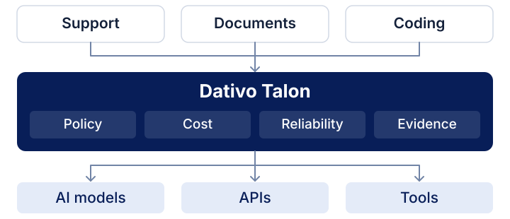

# Scale and operate your AI use cases

Talon is an open-source, self-hosted AI control plane. Apply company policy, control costs, protect sensitive data and operate AI reliably on supported paths through Talon.

## Choose your starting point

### [Try Talon](./quickstart-demo.md)

See policy decisions and signed evidence without a provider API key.

### [Connect an existing app](./add-talon-to-existing-app.md)

Route an existing AI use case through your company policy and verify the connection.

### [Evaluate Talon](./technical-evaluation.md)

Review architecture, security, evidence, deployment and editions before a pilot.

<figure className="qc-docs-diagram">
  <picture>
    <source width="360" height="354" media="(max-width: 600px)" srcSet="/public/assets/talon-control-layer-mobile.svg" />
    
  </picture>
  <figcaption>Keep your existing applications and providers. Configure supported routes through Talon.</figcaption>
</figure>

## Find your integration

- [Model API gateway: OpenAI and Anthropic](./proxy-quickstart.md)
- [n8n: refund approval](./n8n-refund-approvals.md)
- [Claude Code](./claude-code-integration.md)
- [Codex CLI](./codex-cli-integration.md)
- [Governed MCP tools](./mcp-governed-tools.md)
- [All integration paths](./choosing-integration-path.md)

## Already using Talon?

- [Connect the next application](./add-talon-to-existing-app.md#6-connect-the-next-application)
- [Configure company policy](./policy-cookbook.md)
- [Control spending](./cost-governance-by-agent.md)
- [Investigate operations](./operations-console.md)
- [Backup, restore and recovery](./single-node-production.md)
- [Upgrade to v1.17](./upgrading-to-1.17.md)

## Technical trust

[Community and Enterprise](./open-source-and-enterprise.md) · [Trust boundaries](./control-plane-boundaries.md) · [Threat model](./threat-model.md) · [Verify an exact action](./action-gateway-proof.md) · [Release notes](./release-notes.md)

Talon governs only supported routed paths. Signed evidence verifies recorded decisions, not downstream outcomes or automatic compliance. Enterprise integrations and deployment profiles are scoped during evaluation.

[Discuss a pilot](https://dativo.io/pilot/) to explore how to scale and operate AI.
